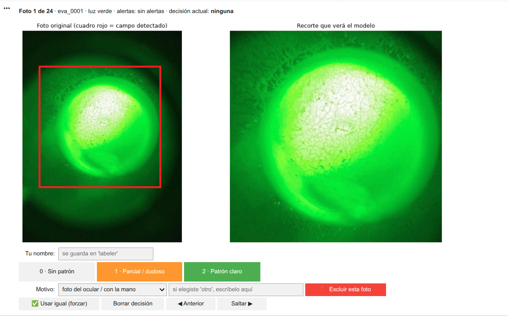

🌍 [English](README.md) | [Español](README-es.md)

# 🔬 EVA Project: Clinical Dataset Preparation Pipeline (Ferning)

## 📌 Project Overview
This repository contains the image processing pipeline for the **EVA Project**. Its primary goal is to take raw photographs of saliva samples—captured through microscopes with varying lighting, sizes, backgrounds, and framing—and transform them into a standardized, clean, and labeled dataset ready for machine learning model training.

By separating data preparation from model training, this pipeline ensures that the test set remains uncontaminated, prevents data leakage, and remains reproducible as new clinical samples are incorporated.

## 🖼️ Data Transformation (Before & After)
The preparation pipeline automatically detects the microscope illumination field and removes background artifacts such as phone edges, hands, or non-relevant noise, preserving only the clinically relevant area.

The image above illustrates the pipeline's core idea: the raw sample is first isolated and standardized, then the relevant region is extracted and used for downstream labeling and model training.

## ⚙️ Pipeline Architecture
The main notebook, `EVA_01_Preparacion_Dataset.ipynb`, documents and executes the full process in the following stages:

1. **Inventory:** Automated generation of the master spreadsheet (`manifiesto.csv`).
2. **Automated Measurement:** Intelligent detection of the microscope field, color profiling, sizing, and quality alerts.
3. **Review & Labeling (Human-in-the-Loop):** Manual validation and clinical ground-truth labeling.
4. **Grouping & Deduplication:** Identification of related images from the same sample/session to prevent leakage across train/test splits.
5. **Data Split:** Automated allocation into development and frozen test sets based on clinical groups.
6. **Export:** Generation of cropped, anonymized images and the final structured dataset.

## 📊 Clinical Classification Criteria
Samples are visually inspected and labeled into 3 levels of crystallization (ferning pattern):

- **Level 0:** No ferning pattern detected.
- **Level 1:** Partial, atypical, or doubtful ferning pattern.
- **Level 2:** Clear, well-defined ferning pattern.

This classification is used as the clinical label for downstream machine learning tasks and for reproducible quality review of the dataset.

## 🚀 How to Use This Repository
1. Place all raw images inside the `/fotos_crudas` directory.
2. Run the notebook steps to generate the initial manifest and dataset inventory.
3. Open `manifiesto.csv` and complete the required manual labeling variables.
4. Re-run the relevant notebook steps to finalize cropping, anonymization, and dataset splitting.

## 📁 Repository Structure
- `/data/` — processed and curated dataset artifacts
- `/fotos_crudas/` — raw microscopy images before cleaning
- `/assets/` — supporting visuals and illustrative examples
- `EVA_01_Preparacion_Dataset.ipynb` — main notebook for the clinical pipeline

## 👩‍⚕️ About the Developer
Developed by **Camila Contreras Ruiz**, combining over 12 years of experience in healthcare with technical innovation and the development of artificial intelligence solutions. This pipeline reflects a strong emphasis on clinical safety, data governance, and reproducibility in real-world medical contexts.
